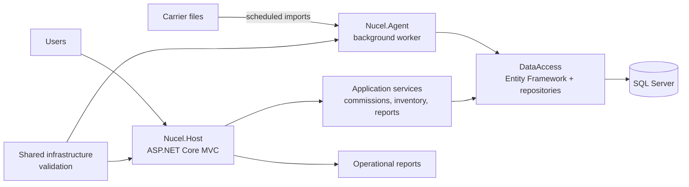

# Nucel — Carrier Reporting & Commissions Platform (Showcase)

> Public showcase of a full-stack project. **No source code is published here.** This repository documents the architecture, stack, and engineering practices of a private project. Source code and a live walkthrough are available on request.

## Overview

Nucel is a **.NET enterprise reporting platform** used for importing carrier data, managing commissions and inventory, and generating operational reports. It combines an **MVC web application** for interactive management with a **background agent** that processes carrier file imports automatically — a classic back-office automation system with multiple moving parts.

## Highlights

- Two-runtime design: interactive MVC host + autonomous background import agent
- Commission and inventory management over carrier data feeds
- Automated file-import pipeline (background worker) for operational data
- Security remediation program: credentials removed from source, environment-driven configuration that **fails closed** when required values are missing
- Privacy-conscious data handling: sanitized fixtures only, logs that exclude credentials, JWTs, and personal data

## Stack

| Layer | Technology |
| --- | --- |
| Host | ASP.NET Core MVC web application |
| Agent | Background file-import worker |
| Domain | Application services and feature modules |
| Data access | Entity Framework model and repositories (SQL Server) |
| Shared | Validation and infrastructure library |
| Testing | Dedicated unit-test target on .NET 8 |
| CI/CD | GitHub Actions with managed dependency audit |

## Architecture

**Project boundaries:**

- `Host` — MVC web application: login, uploads, management, and reporting
- `Agent` — background file-import worker for carrier data feeds
- `Application services` — commissions, inventory, and report features
- `DataAccess` — Entity Framework model and repositories
- `Shared infrastructure` — validation rules and cross-cutting concerns
- `UnitTests` — dedicated .NET 8 recovery test target

**Key decisions:**

- The import workload is isolated in a dedicated background agent, so long-running carrier file processing never blocks the interactive host.
- A shared infrastructure library centralizes validation so the host and agent apply identical business rules.
- All configuration is environment-driven and **fails closed**: the application refuses to start without required values instead of falling back to insecure defaults.
- Historical embedded credentials (database, JWT signing, mobile API tokens) were removed from source and tracked in a formal rotation plan with least-privilege replacements.

## Security & data handling

- Formal credential-response procedure: disable legacy logins, rotate JWT secrets, revoke mobile API tokens, and review audit logs
- Repository policy: sanitized fixtures only — no customer uploads or database backups in Git
- Logging discipline: logs must exclude credentials, JWTs, personal data, and imported row contents
- Documented modernization roadmap: target framework upgrades, dependency migration, integration tests for migrations/imports/commissions/tenant boundaries, authenticated browser tests, and a non-root production image before release

## Quality gates

- Both runtimes compile on **.NET 8** with a clean managed dependency audit
- Dedicated unit-test project covering recovery scenarios
- CI runs the dependency audit on every change
- Release gate documented: staging acceptance and rollback plan required before production

## Skills demonstrated

ASP.NET Core / .NET 8, Entity Framework, background processing architecture, SQL Server, enterprise reporting, application security remediation (credential rotation, fail-closed configuration, data sanitization), testing strategy, operational runbooks, legacy modernization planning.

---

*This is a documentation-only showcase. The private repository contains the full implementation: MVC host, background agent, services, data access layer, tests, and CI workflows.*
